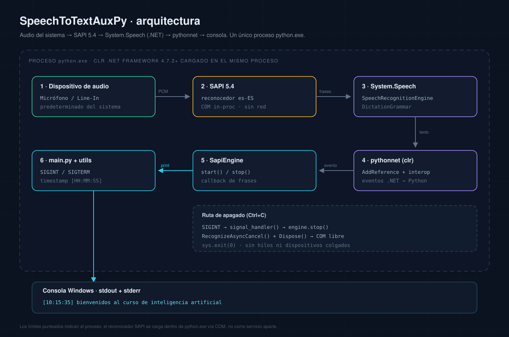
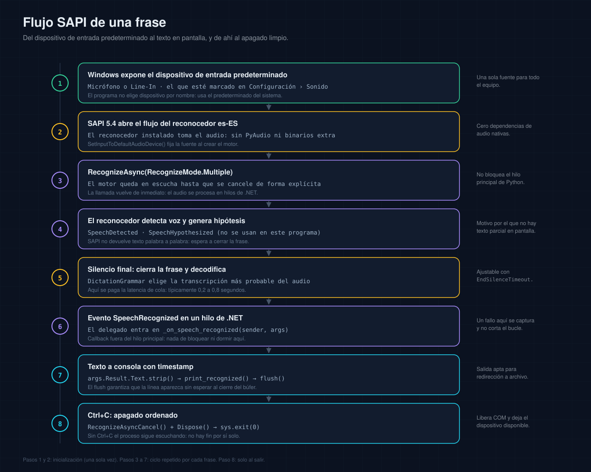
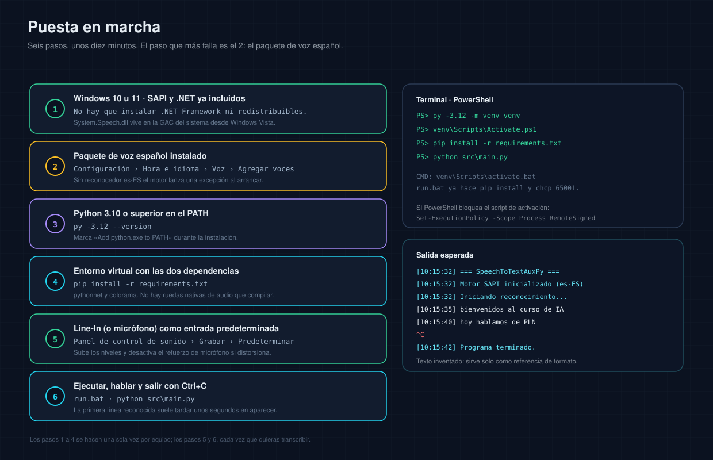

<div align="center">

# 🎤 SpeechToTextAuxPy

**Transcripción continua en español sobre Windows, sin nube y sin modelos que descargar.**
Captura la entrada de audio predeterminada —micrófono o *line-in*— y escribe cada frase en la consola con su hora exacta, usando el motor de voz que ya vive dentro de Windows.

[](https://www.python.org/)
[](#-requisitos)
[](#-principio-de-funcionamiento)
[](#-instalación)
[](#-privacidad)
[](LICENSE)

</div>

---

```
[10:15:32] === SpeechToTextAuxPy ===
[10:15:32] Motor SAPI inicializado correctamente (idioma: es-ES)
[10:15:35] bienvenidos al curso de inteligencia artificial
[10:15:40] hoy vamos a hablar sobre procesamiento del lenguaje natural
^C
[10:15:42] Programa terminado.
```

---

## 📑 Índice

- [Qué es](#-qué-es)
- [El problema que resuelve](#-el-problema-que-resuelve)
- [Principio de funcionamiento](#-principio-de-funcionamiento)
- [Arquitectura](#-arquitectura)
- [Requisitos](#-requisitos)
- [Instalación](#-instalación)
- [Configuración de la entrada line-in](#-configuración-de-la-entrada-line-in)
- [Uso](#-uso)
- [Ejemplo de salida](#-ejemplo-de-salida)
- [API de las clases](#-api-de-las-clases)
- [Manejo de errores](#-manejo-de-errores)
- [Privacidad](#-privacidad)
- [Rendimiento y latencia](#-rendimiento-y-latencia)
- [Solución de problemas](#-solución-de-problemas)
- [Limitaciones](#-limitaciones)
- [Cómo se construyó](#-cómo-se-construyó)
- [Estructura del proyecto](#-estructura-del-proyecto)
- [Documentación](#-documentación)
- [Referencias](#-referencias)
- [Licencia](#-licencia)

---

## 🎯 Qué es

**SpeechToTextAuxPy** es una herramienta de línea de comandos para Windows que convierte voz en texto de forma continua. Se apoya en **SAPI 5.4**, el motor de reconocimiento que Microsoft incluye en el sistema operativo, y lo alcanza desde Python mediante **pythonnet**, el puente que carga el runtime de .NET dentro del propio proceso del intérprete.

No es un juguete de demostración ni un envoltorio de una API en la nube: es una utilidad pequeña, terminada y honesta, pensada para quedarse abierta en una ventana de consola durante horas. Arrancas, hablas (o dejas que hable una mesa de mezclas), lees, y sales con `Ctrl+C`. Nada más.

| | |
|---|---|
| **Qué hace** | Escucha el dispositivo de entrada predeterminado y escribe cada frase reconocida como `[HH:MM:SS] texto`. |
| **Cómo lo hace** | `System.Speech.Recognition` (SAPI 5.4) a través de pythonnet, con `DictationGrammar` y `RecognizeAsync(Multiple)`. |
| **Cuánto dura** | Indefinidamente. El proceso no termina solo: solo con `Ctrl+C`. |
| **Qué necesita** | Windows 10/11, Python 3.10+, y el paquete de voz español de Windows instalado. |
| **Qué no necesita** | Internet, tarjeta gráfica, modelos de IA, claves de API, cuenta en ningún servicio. |
| **Qué cuesta** | Dos dependencias de Python (`pythonnet`, `colorama`) y entre 60 y 120 MB de RAM. |

### Para quién es

- Quien quiere **transcribir una clase, una charla o una reunión** que ya tiene en una salida de audio, sin subir nada a ningún sitio.
- Quien necesita **probar un micrófono o una entrada line-in** y quiere una señal inmediata de que el audio llega y se entiende.
- Quien quiere **integrar reconocimiento de voz en un script** de Windows y prefiere una clase reutilizable (`SapiEngine`) a un framework completo.

### Para quién no es

- Quien busca **subtitulado profesional** con puntuación, diarización y baja latencia: necesita un modelo neuronal, no SAPI.
- Quien trabaja en **Linux o macOS**: el componente del que depende no existe allí.
- Quien necesita **guardar el audio**: este programa no graba, solo transcribe.
- Quien espera **precisión de dictado moderna**: el reconocedor de Windows es de la familia de los modelos acústicos clásicos. Sorprende en audio limpio y sufre con ruido.

---

## 🧩 El problema que resuelve

Windows trae reconocimiento de voz desde hace veinte años, pero está escondido: vive en el Panel de control como "Reconocimiento de voz de Windows", está pensado para dictar dentro de aplicaciones y no ofrece una forma cómoda de volcar texto a una consola o a un archivo. Las alternativas modernas —APIs en la nube, modelos descargables— resuelven el problema con creces, pero introducen dos costes que aquí eran inaceptables: **dependencia de red** y **salida de audio del equipo**.

Este proyecto hace una sola cosa: `audio que ya tienes → motor que ya tienes → texto en la consola`. Sin modelos que descargar, sin servicios que configurar y sin una sola conexión saliente. El código son ~250 líneas que puedes leer en diez minutos, y el caso de uso original —capturar la salida de una mesa de audio por el line-in y tomar notas mientras se escucha— explica el resto del diseño.

---

## ⚙️ Principio de funcionamiento

La cadena tiene cinco capas. Entenderlas explica tanto las virtudes como los límites del programa.

```
┌──────────────────┐   ┌──────────────────┐   ┌───────────────────────┐
│  Dispositivo de  │   │                  │   │  System.Speech (.NET) │
│  audio           │──▶│  SAPI 5.4        │──▶│  SpeechRecognition-   │
│  (predeterminado)│   │  reconocedor es  │   │  Engine + Grammar     │
└──────────────────┘   └──────────────────┘   └───────────┬───────────┘
                                                          │ eventos
                                                          ▼
┌──────────────────┐   ┌──────────────────┐   ┌───────────────────────┐
│  Consola         │◀──│  console_utils   │◀──│  pythonnet (clr)      │
│  [HH:MM:SS] txt  │   │  color + flush   │   │  SapiEngine           │
└──────────────────┘   └──────────────────┘   └───────────────────────┘
```

<p align="center">
  
</p>

### Capa 1 · El audio

El programa **no abre el micrófono**. Le pide a Windows el dispositivo de entrada predeterminado, y Windows decide cuál es. Esa decisión —deliberada— tiene dos efectos: simplifica el código a una línea (`SetInputToDefaultAudioDevice()`) y traslada al panel de sonido cualquier cambio de fuente. Ventaja: funciona con micrófono USB, jack, line-in o interfaz externa sin tocar código. Desventaja: no se puede elegir dispositivo por nombre sin modificar el programa.

El audio no se almacena en ningún momento. SAPI lo consume, lo analiza y lo descarta.

### Capa 2 · SAPI 5.4, el motor real

**SAPI** (*Speech Application Programming Interface*) es la API de voz de Windows. La versión 5.4, publicada a principios de los 2000, sigue siendo la que da servicio en Windows 10 y 11. Está construida sobre COM y consta de dos mitades: síntesis (TTS) y reconocimiento (SR). Aquí solo se usa la segunda.

El reconocimiento no lo hace un algoritmo genérico: lo hace un **reconocedor instalado**, identificado por un `Id` y una cultura (`es-ES`, `en-US`…). Ese reconocedor contiene el modelo acústico y el modelo de lenguaje de su idioma. **Si no está instalado, no hay nada que hacer**: por eso el paquete de voz español es un requisito y no una recomendación.

El reconocedor se carga **dentro del proceso** que lo usa. No hay un servicio `sapi.exe` al que conectarse: cuando el programa arranca, SAPI vive en la misma memoria que Python.

### Capa 3 · System.Speech, la fachada administrada

Escribir COM a mano desde Python es posible pero ingrato. `.NET Framework` incluye `System.Speech`, un ensamblado que envuelve SAPI 5.4 con clases administradas. Las que importan aquí:

| Clase | Papel |
|---|---|
| `SpeechRecognitionEngine` | El motor. Configura entrada, carga gramáticas, arranca y detiene el reconocimiento, dispara eventos. |
| `DictationGrammar` | La gramática de **lenguaje libre**: no una lista de comandos, sino "cualquier frase en el idioma del reconocedor". |
| `RecognizeMode` | Enum con `Single` (una frase y para) y `Multiple` (sigue escuchando). El programa usa `Multiple`. |
| `CultureInfo` | Selecciona el reconocedor por idioma (`System.Globalization`). |
| `RecognitionResult` | El resultado de una frase: `Text`, `Confidence`, alternativas. Implementa `IDisposable`. |

`System.Speech` **solo existe en .NET Framework**, no en .NET 6/7/8. Ese detalle condiciona todo el stack y es la causa de la mitad de los problemas de instalación ajenos.

### Capa 4 · pythonnet, el puente

`pythonnet` carga el CLR en el proceso de Python y expone los ensamblados como si fueran módulos:

```python
import clr
clr.AddReference("System.Speech")

from System.Speech.Recognition import SpeechRecognitionEngine, DictationGrammar, RecognizeMode
from System.Globalization import CultureInfo

engine = SpeechRecognitionEngine(CultureInfo("es-ES"))
engine.SetInputToDefaultAudioDevice()
engine.LoadGrammar(DictationGrammar())
engine.SpeechRecognized += lambda s, e: print(e.Result.Text)
engine.RecognizeAsync(RecognizeMode.Multiple)
```

Eso es, esencialmente, el programa completo. Todo lo demás —clase, manejo de errores, colores, señales— es lo que convierte esas ocho líneas en una herramienta que se puede dejar abierta horas sin supervisión.

Dos matices que importan:

- **Los eventos cruzan la frontera.** `SpeechRecognized += handler` registra un delegado .NET que invoca código Python. Ese código se ejecuta en un hilo de .NET, con el GIL adquirido por pythonnet.
- **El runtime elegido importa.** En Windows, pythonnet usa .NET Framework por defecto, que es donde vive `System.Speech`. Forzar `coreclr` rompe la resolución del ensamblado.

### Capa 5 · La aplicación

`SapiEngine` encapsula el ciclo de vida; `console_utils` da formato; `main` orquesta y atiende señales. El flujo de una frase es siempre el mismo:

<p align="center">
  
</p>

1. El reconocedor detecta voz (`SpeechDetected`) y produce hipótesis internas (`SpeechHypothesized`) que este programa **ignora**.
2. Cuando detecta silencio final, cierra la frase y la decodifica con la gramática de dictado.
3. Dispara `SpeechRecognized` en un hilo de .NET.
4. El delegado lee `args.Result.Text`, lo limpia con `strip()` y lo imprime con timestamp y `flush()`.
5. Libera el resultado con `Dispose()`.

Ese paso 2 es la razón de la latencia: **no hay texto mientras hablas**, solo al cerrar la frase.

---

## 🏗️ Arquitectura

### Módulos

| Módulo | Líneas | Responsabilidad | Depende de |
|---|---:|---|---|
| `src/main.py` | ~135 | Punto de entrada, UTF-8 de consola, señales `SIGINT`/`SIGTERM`, bucle de espera, códigos de salida. | `sapi_engine`, `console_utils` |
| `src/sapi_engine.py` | ~200 | `SapiEngine`: creación del motor, evento de reconocimiento, arranque, parada y liberación de COM. | `console_utils`, pythonnet |
| `src/console_utils.py` | ~108 | Formato de salida: timestamp, colores, separación `stdout`/`stderr`, fallback sin `colorama`. | `colorama` (opcional) |

### Grafo de dependencias

```
main.py ──▶ sapi_engine.py ──▶ console_utils.py ──▶ colorama (opcional)
   │                                  ▲
   └──────────────────────────────────┘

sapi_engine.py ──▶ clr (pythonnet) ──▶ System.Speech ──▶ SAPI 5.4 ──▶ dispositivo de audio
```

No hay dependencias circulares ni estado compartido más allá de la variable global `_engine` en `main.py`, necesaria porque el manejador de señales no recibe contexto.

### Ciclo de vida

```
__init__()          start()              (frases)            stop()
   │                   │                    │                  │
   ▼                   ▼                    ▼                  ▼
crear motor  ──▶  RecognizeAsync  ──▶  SpeechRecognized  ──▶  cancel + Dispose
(listo)            (escuchando)         (N veces)             (detenido)
```

- **No reutilizable:** tras `stop()`, el motor queda en `None`; volver a escuchar exige instanciar otro.
- **Idempotente:** llamar dos veces a `stop()` no falla; informa que ya estaba detenido.
- **Ordenada:** primero se cancela, después se libera, y solo al final se anulan las referencias.

### Modelo de hilos

| Hilo | Qué ejecuta |
|---|---|
| Principal (CPython) | `main()`, señales, bucle de espera de 500 ms. |
| Hilos de .NET | Captura de audio, detección de voz, decodificación. |
| Hilo del delegado | `_on_speech_recognized` → impresión en consola. |

El callback **no corre en el hilo principal**. En este programa no toca estado compartido, así que no hay carreras; pero es la primera trampa al extender el código (ver [`docs/desarrollador.md`](docs/desarrollador.md#3-modelo-de-ejecución)).

---

## ✅ Requisitos

### Sistema

| Componente | Mínimo | Notas |
|---|---|---|
| **Sistema operativo** | Windows 10 (1803+) | Probado en Windows 10. Windows 11 conserva SAPI y .NET Framework 4.8. |
| **Arquitectura** | x86-64 | También x86 con Python de 32 bits. |
| **Python** | 3.10 | 3.11 / 3.12 / 3.13 funcionan. |
| **.NET Framework** | 4.7.2 | Incluido en Windows 10; no se instala aparte. |
| **Paquete de voz** | Español (España) o (México) | **Imprescindible**: aporta el reconocedor `es-ES`. |
| **Audio** | Micrófono o line-in operativo | Cualquier dispositivo que Windows reconozca como entrada. |
| **RAM** | 60–120 MB libres | El CLR se carga en el proceso. |
| **Disco** | ~15 MB | Código + dependencias. |
| **Permisos** | Usuario estándar | No requiere administrador. |

### El paquete de voz, en detalle

Windows distingue la **voz TTS** (el equipo habla) del **reconocedor SR** (el equipo escucha). Instalar la primera no garantiza la segunda. La ruta para agregar ambas:

1. **Configuración** → **Hora e idioma** → **Voz**.
2. En *Administrar voces*, pulsa **Agregar voces**.
3. Elige **Español (España)** y espera la descarga.
4. Reinicia la sesión si el motor no aparece de inmediato.

Verificación fiable —enumera lo que el sistema tiene de verdad, sin adivinar—:

```python
import clr
clr.AddReference("System.Speech")
from System.Speech.Recognition import SpeechRecognitionEngine

for info in SpeechRecognitionEngine.InstalledRecognizers():
    print(f"{info.Culture.Name:8} | {info.Name} | {info.Description}")
```

Salida esperada en un equipo correctamente preparado:

```
es-ES    | MS-3082-80-DESK | Microsoft Speech Recognizer 8.0 for Windows (Spanish - Spain)
```

Si no hay ninguna línea `es-ES`, el programa arrancará, fallará al crear el motor y saldrá con código `2` y un mensaje que indica qué instalar.

---

## 📦 Instalación

Las dependencias están declaradas en **[`requirements.txt`](requirements.txt)**:

```
pythonnet>=3.0.0
colorama>=0.4.6
```

### 1 · Crear el entorno virtual e instalar

```bash
python3 -m venv venv
source venv/bin/activate        # Linux/Mac
venv\Scripts\activate           # Windows
pip install -r requirements.txt
```

> **Nota:** el programa es **exclusivo de Windows**; los comandos de Linux/macOS se incluyen porque son el estándar de cualquier proyecto Python y porque el entorno virtual es la práctica correcta también aquí. En Windows, además, puedes usar `venv\Scripts\Activate.ps1` desde PowerShell.

En Windows, con el lanzador incluido:

```bat
run.bat
```

El lanzador hace tres cosas: `chcp 65001` (consola en UTF-8), `pip install -r requirements.txt` (red de seguridad para la primera ejecución) y `python src/main.py`.

### 2 · Verificar que el puente funciona

```bat
python -c "import clr; print('pythonnet OK')"
```

Si imprime `pythonnet OK`, el CLR se carga. Si lanza `ModuleNotFoundError: No module named 'clr'`, el entorno virtual no está activado o `pip` instaló en otro intérprete.

### 3 · Ejecutar

```bat
python src\main.py
```

<p align="center">
  
</p>

### Qué aporta cada dependencia

`pythonnet` es obligatorio: sin él no existe puente con .NET y el programa termina con código `1`. `colorama` es opcional: sin él se pierden los colores, no la funcionalidad. Ninguna compila código nativo ni descarga modelos.

---

## 🎚️ Configuración de la entrada line-in

El programa usa el **dispositivo de entrada predeterminado**. Configurarlo bien es el 90 % del éxito.

### Micrófono

1. Conecta el micrófono (jack o USB).
2. **Configuración** → **Sistema** → **Sonido** → **Entrada**.
3. Selecciona el dispositivo y habla: la barra debe moverse con claridad.
4. Ajusta el volumen hasta que el habla normal llegue al 60–85 % de la barra.

### Line-in (entrada auxiliar)

Para capturar la salida de una mesa de mezclas, un grabador, una radio, un receptor o la salida de otro PC:

1. Conecta el cable a la toma **azul** (`Line In`) del panel trasero, o a la interfaz USB correspondiente.
2. Abre **Panel de control de sonido** → pestaña **Grabar**.
3. Localiza **Entrada auxiliar / Line-In**. Si no aparece: clic derecho en una zona vacía → **Mostrar dispositivos deshabilitados** → habilitar.
4. Clic derecho → **Establecer como dispositivo predeterminado**.
5. **Propiedades** → **Niveles**: sube el volumen. En **Mejoras**, desactiva la supresión de ruido si el audio ya viene limpio de la mesa.
6. **Escuchar este dispositivo** debe quedar **desactivado** (si no, se realimenta y el reconocimiento empeora).

### Niveles, formato y exclusividad

| Ajuste | Recomendación | Por qué |
|---|---|---|
| **Nivel de entrada** | Picos entre 60 % y 85 % | Por debajo, el motor no detecta voz; por encima, satura (*clipping*) y la transcripción se degrada. |
| **Formato predeterminado** | 16 kHz, 16 bits, mono si está disponible | Es el formato interno del reconocedor: evita remuestreo. Si no aparece, deja 44,1/48 kHz; funciona igual. |
| **Control exclusivo** | Desmarcado | Evita que una DAW o una videollamada se quede con el dispositivo. |
| **Mejoras** | Solo las que necesites | Cada filtro agresivo recorta información que el modelo acústico usa. |
| **Silencio del sistema** | Sonidos de Windows desactivados | Un *ding* a mitad de frase se cuela en la transcripción. |

Cambiar de dispositivo **mientras el programa corre** no tiene efecto: el motor ya abrió el anterior. Reinicia para que tome el nuevo.

---

## 🚀 Uso

### Arrancar

```bat
:: opción 1: lanzador (instala dependencias, ajusta UTF-8)
run.bat

:: opción 2: directo, con el entorno virtual activo
venv\Scripts\activate
python src\main.py
```

### Durante la sesión

- Habla con normalidad, sin palabras clave ni comandos: cada pausa cierra una frase y produce una línea nueva.
- No hay que pulsar nada entre frases y la ventana puede estar minimizada.
- No lances dos instancias: la segunda puede encontrar el dispositivo ocupado.

### Detener

`Ctrl+C`. La secuencia de cierre es ordenada:

```
[10:15:52] Ctrl+C recibido. Deteniendo...
[10:15:52] Reconocimiento de voz detenido.
[10:15:52] Programa terminado.
```

Cerrar la ventana con la X también termina el proceso, pero se salta la liberación explícita del motor.

### Guardar la transcripción

```bat
python src\main.py > transcripcion.txt
```

Para verla y guardarla a la vez:

```powershell
python src\main.py | Tee-Object -FilePath transcripcion.txt
```

Los mensajes de estado también acaban en el archivo (van por `stdout`). Los errores van por `stderr`; para capturar ambos:

```bat
python src\main.py > transcripcion.txt 2>&1
```

Como cada línea se escribe con `flush()`, la redirección funciona en tiempo real: no hay que esperar al cierre para ver contenido en el archivo.

### Ejecución desatendida

Con el Programador de tareas: acción `venv\Scripts\python.exe`, argumentos `src\main.py`, directorio de inicio la carpeta `src`, desencadenador "al iniciar sesión". Si usas `pythonw.exe` no hay salida estándar: redirige a archivo o la transcripción se perderá.

---

## 💻 Ejemplo de salida

### Sesión con line-in (clase o conferencia)

```
[09:02:11] === SpeechToTextAuxPy ===
[09:02:11] Reconocimiento de voz continuo mediante SAPI (System.Speech)
[09:02:11] Motor SAPI inicializado correctamente (idioma: es-ES)
[09:02:11] Iniciando reconocimiento de voz en español...
[09:02:11] Habla al micrófono/entrada auxiliar. Ctrl+C para salir.
[09:02:11] Esperando entrada de voz...
[09:03:04] buenos días vamos a comenzar la clase de hoy
[09:03:12] el tema es la arquitectura de los sistemas distribuidos
[09:03:27] recordad que el examen práctico es la semana que viene
[09:03:41] alguna pregunta sobre el temario anterior
[09:03:58] perfecto seguimos con el modelo de capas
^C
[09:14:58] Ctrl+C recibido. Deteniendo...
[09:14:58] Reconocimiento de voz detenido.
[09:14:58] Programa terminado.
```

### Dictado corto con micrófono

```
[18:40:05] Motor SAPI inicializado correctamente (idioma: es-ES)
[18:40:09] nota para el lunes comprar dos cables hdmi
[18:40:16] llamar al proveedor y confirmar el presupuesto
[18:40:24] revisar la factura de marzo antes del viernes
```

### Error típico: falta el paquete de voz

```
[11:02:03] === SpeechToTextAuxPy ===
[11:02:03] ERROR: El idioma 'es-ES' no está soportado.
   -> Asegúrate de tener instalado el paquete de voz en español.
   -> Configuración > Hora e idioma > Voz > Agregar voz
```

Salida por `stderr`, código de salida `2`. Con el dispositivo de audio ausente el mensaje es análogo y el código, el mismo.

---

## 🧠 API de las clases

El proyecto está diseñado para que puedas reutilizar `SapiEngine` en otro script sin arrastrar la consola ni los colores.

### `SapiEngine`

```python
class SapiEngine:
    def __init__(self, language: str = "es-ES") -> None
    def start(self) -> None
    def stop(self) -> None
```

| Miembro | Tipo | Descripción |
|---|---|---|
| `language` | `str` | Cultura del reconocedor (`"es-ES"`, `"es-MX"`, `"en-US"`). |
| `_engine` | `.NET` o `None` | `SpeechRecognitionEngine` activo. |
| `_grammar` | `.NET` o `None` | `DictationGrammar` cargada. |
| `__init__()` | — | Carga `System.Speech`, crea el motor, abre el dispositivo, carga la gramática y suscribe el evento. Lanza `ImportError` si falta pythonnet y `RuntimeError` si falla .NET. |
| `start()` | — | `RecognizeAsync(RecognizeMode.Multiple)`. Retorna de inmediato: la escucha ocurre en hilos de .NET. |
| `stop()` | — | `RecognizeAsyncCancel()` + `Dispose()`, y deja el objeto inutilizable. Idempotente. |
| `_on_speech_recognized(sender, args)` | callback | Imprime el texto y libera el resultado. |

**Ejemplo de uso autónomo:**

```python
import sys
sys.path.insert(0, "src")

from sapi_engine import SapiEngine
import console_utils

engine = SapiEngine(language="es-ES")
engine.start()

console_utils.print_info("Escuchando. Ctrl+C para salir.")
try:
    while True:
        import time
        time.sleep(0.5)
except KeyboardInterrupt:
    pass
finally:
    engine.stop()
```

**Ejemplo de extensión: guardar a archivo sin perder la consola**

Subclasifica `SapiEngine`, abre un archivo con `buffering=1` (escritura por línea), escribe en `_on_speech_recognized` **antes** de llamar a `super()` y ciérralo en `stop()`. El código completo está en [`docs/desarrollador.md`](docs/desarrollador.md#87-escribir-a-archivo-desde-el-propio-programa).

### `console_utils`

```python
COLORAMA_DISPONIBLE: bool

def print_timestamp(color: str = Fore.CYAN, stream=sys.stdout) -> None
def print_recognized(text: str) -> None
def print_info(message: str) -> None
def print_error(message: str) -> None
```

| Función | Flujo | Formato | Uso |
|---|---|---|---|
| `print_timestamp` | el que se le pase | `[HH:MM:SS] ` | Pieza común; no se llama desde fuera salvo para formatos propios. |
| `print_recognized` | `stdout` | `[HH:MM:SS] texto` | Cada frase reconocida. |
| `print_info` | `stdout` | `[HH:MM:SS] mensaje` | Estado del programa. |
| `print_error` | `stderr` | `[HH:MM:SS] ERROR: mensaje` | Fallos. |

Todas hacen `flush()`: la salida es visible al instante incluso redirigida. La tercera línea de `print_error` va por `stderr`, así que un `2> errores.log` la separa del resto.

### Variables y constantes de `main.py`

| Nombre | Tipo | Descripción |
|---|---|---|
| `_engine` | `SapiEngine` o `None` | Referencia global para el manejador de señales. |
| `signal_handler(signal_num, frame)` | función | Cierra el motor y sale con código `0`. |
| `main()` | función | Orquesta todo; traduce excepciones a códigos de salida. |

---

## 🚨 Manejo de errores

### Filosofía

Tres reglas, aplicadas sin excepción:

1. **Todo fallo se explica.** Ningún camino termina con un *traceback* críptico y nada más.
2. **Cada tipo de fallo tiene su código de salida**, para que un script pueda distinguirlos.
3. **Un fallo procesando una frase no tumba la sesión.** El callback está aislado.

### Traducción de errores

| Situación | Detección | Mensaje | Código |
|---|---|---|---|
| Falta `pythonnet` | `ImportError` | "pythonnet no está instalado. Ejecuta: pip install pythonnet>=3.0.0" | `1` |
| Reconocedor del idioma ausente | texto con `culture`/`language` | Instrucciones para agregar la voz | `2` |
| Sin dispositivo de entrada | texto con `device`/`audio` | Instrucciones para conectar micrófono/line-in | `2` |
| Fallo .NET no clasificado | `Exception` | "Error al inicializar SAPI: …" | `2` |
| Fallo al arrancar la escucha | `Exception` en `start()` | "Error al iniciar reconocimiento: …" | `2` |
| Error en el callback | `Exception` | "Error en callback de reconocimiento: …" | sesión continúa |
| Error al liberar | `Exception` | "Error al cancelar reconocimiento: …" | sesión termina |

### Códigos de salida

| Código | Significado | Qué hacer |
|---|---|---|
| `0` | Final normal (`Ctrl+C`) | Nada. |
| `1` | Dependencia de Python ausente | Activar `venv` e instalar `requirements.txt`. |
| `2` | Fallo de SAPI (idioma, audio, arranque) | Revisar paquete de voz y dispositivo. |
| `3` | Excepción no clasificada | Leer el mensaje e informar. |

### Separación de flujos

Frases y estado van por `stdout`; errores, por `stderr`. Esa separación permite usar el programa como filtro dentro de una tubería sin que los avisos contaminen el texto.

---

## 🔒 Privacidad

El programa **no abre conexiones de red**. No hay `requests`, ni `urllib`, ni sockets, ni telemetría. Puedes verificarlo: las únicas importaciones son `signal`, `sys`, `datetime`, `clr` y `colorama`.

| Pregunta | Respuesta |
|---|---|
| ¿Se envía audio a algún servidor? | No. El reconocimiento ocurre en el proceso, con el reconocedor instalado en el equipo. |
| ¿Se guarda audio en disco? | No. SAPI consume el flujo y lo descarta. |
| ¿Se guarda la transcripción? | No, salvo que redirijas la salida a un archivo. |
| ¿Hay claves de API o cuentas? | Ninguna. |
| ¿Funciona sin internet? | Sí, una vez instaladas las dependencias. |

**Matiz honesto:** Windows tiene un ajuste llamado *Reconocimiento de voz en línea* que afecta a otras funciones del sistema. Este programa usa el reconocedor **SAPI 5.4 local** y no depende de ese ajuste: no hay ninguna llamada saliente en el código.

La contrapartida de la privacidad total es la calidad: un modelo local clásico no compite con un servicio en la nube moderno, y eso se nota en ruido, acentos marcados y vocabulario técnico.

---

## ⏱️ Rendimiento y latencia

### Qué esperar

| Métrica | Valor típico | Comentario |
|---|---|---|
| Arranque hasta el primer mensaje | 0,6–1,8 s | Dominado por la carga del CLR. |
| Latencia de cola (fin de frase → texto) | 0,2–0,8 s | Silencio final + decodificación. |
| CPU en reposo | ~0 % | El proceso espera. |
| CPU al decodificar una frase | 20–80 ms de un núcleo | A ráfagas. |
| Memoria residente | 60–120 MB | CLR + ensamblados + búferes. |
| Throughput | Sin límite práctico | Horas de sesión sin degradación apreciable. |

### Por qué la latencia no es "streaming"

SAPI no emite palabras mientras hablas: acumula audio, detecta el final de la frase por silencio y entonces decodifica la secuencia completa. El resultado es más preciso que un reconocimiento palabra a palabra, pero introduce un retardo perceptible que ningún ajuste elimina del todo.

```
hablas ────────────────┐
                       │ silencio final (0,2–0,8 s)
                       ▼
                    decodifica (0,02–0,08 s)
                       ▼
                 línea en pantalla
```

### Cómo mejorarlo

1. **Audio limpio.** Es el factor con más impacto, muy por encima de cualquier ajuste de software.
2. **Nivel correcto.** Ni saturación ni susurro.
3. **Fuente directa.** Line-in de una mesa supera a "grabar con el móvil y reproducir".
4. **Formato nativo.** 16 kHz mono evita remuestreo.
5. **`EndSilenceTimeout` más bajo** (requiere tocar código): frases más rápidas y más fragmentadas.

Lo que lo empeora sin que se note: sesión RDP (audio comprimido), antivirus escaneando al redirigir, música o ventiladores de fondo, y hablantes que se pisan.

---

## 🩺 Solución de problemas

### El programa no arranca

| Síntoma | Causa probable | Solución |
|---|---|---|
| `'python' no se reconoce…` | Python no está en el `PATH` | Reinstala marcando *Add python.exe to PATH*, o usa el lanzador `py`. |
| `ModuleNotFoundError: No module named 'clr'` | `pythonnet` no instalado en el intérprete activo | Activa el `venv` y `pip install -r requirements.txt`. |
| `ModuleNotFoundError: No module named 'sapi_engine'` | Ejecutaste desde otra carpeta | `python src\main.py` desde la raíz del proyecto, o `cd src` antes. |
| `ImportError: DLL load failed` | Arquitectura incompatible (Python x86 con .NET x64, o al revés) | Reinstala Python de 64 bits. |

### Falla el motor

| Síntoma | Causa probable | Solución |
|---|---|---|
| `El idioma 'es-ES' no está soportado` | No hay reconocedor español | Configuración → Hora e idioma → Voz → Agregar voces. |
| `No se encontró dispositivo de entrada de audio` | Ningún dispositivo habilitado | Panel de sonido → Grabar → habilitar y predeterminar. |
| `Error al iniciar reconocimiento` | Dispositivo tomado en exclusiva | Cierra la app que lo retiene o desactiva el modo exclusivo. |
| `FileNotFoundException: System.Speech` | Runtime `coreclr` activo | Quita `PYTHONNET_RUNTIME` del entorno. |
| Falla solo en otro PC | `.NET Framework` antiguo | Actualiza Windows o instala .NET Framework 4.7.2+. |

### Arranca, pero no aparece texto

1. **Comprueba que el audio llega.** Panel de sonido → Grabar → habla y mira la barra. Si no se mueve, el problema es del dispositivo, no del programa.
2. **Comprueba el dispositivo predeterminado.** Es frecuente tener el micrófono correcto pero otro dispositivo marcado como predeterminado.
3. **Comprueba el idioma.** Si el reconocedor instalado es `en-US`, el texto será incomprensible, no vacío.
4. **Comprueba el nivel.** Un nivel muy bajo hace que el motor descarte todo como ruido.
5. **Habla en frases completas.** "Sí", "vale", "mm" se descartan por baja confianza.

### El texto sale mal

| Síntoma | Causa | Solución |
|---|---|---|
| Acentos corruptos (`ñ`) | Consola sin UTF-8 | Usa `run.bat` o `chcp 65001` antes de lanzar. |
| Palabras inventadas | Ruido, eco o saturación | Baja el nivel, desactiva "Escuchar este dispositivo". |
| Falta puntuación | Comportamiento normal de SAPI | Postprocesa el texto o dicta los signos. |
| Cambia de idioma solo | Reconocedor equivocado | Verifica con `InstalledRecognizers()`. |
| Corta frases a mitad | Pausas naturales | Habla más continuo o sube `EndSilenceTimeout`. |

### Problemas de consola

Sin `colorama` no hay colores, pero todo lo demás funciona. Caracteres raros en PowerShell se corrigen con `chcp 65001` o usando `run.bat`. Si nada aparece al redirigir, revisa la herramienta que consume la salida: el programa hace `flush()` en cada línea. Y si `Ctrl+C` tarda hasta medio segundo, es el intervalo de espera del bucle principal, no un cuelgue.

---

## ⚠️ Limitaciones

Están aquí para que nadie las descubra después de integrar el programa en algo importante.

1. **Solo Windows.** `System.Speech` vive en .NET Framework; no hay equivalente en Linux/macOS.
2. **Un idioma por ejecución.** Se fija al crear el motor; cambiarlo requiere reiniciar.
3. **Sin streaming a archivo.** No escribe audio ni transcripción por sí mismo; se resuelve redirigiendo la salida.
4. **Sin texto parcial.** Solo se muestra la frase cerrada, no las hipótesis intermedias.
5. **Sin selección de dispositivo.** Siempre el predeterminado del sistema, salvo modificación del código.
6. **Sin diarización.** No distingue hablantes.
7. **Sin control de confianza.** Se imprime todo lo aceptado, sin filtrar por `Confidence`.
8. **Sin pausa ni reanudación.** Solo arrancar y parar.
9. **Calidad dependiente del reconocedor del sistema.** No es un modelo neuronal; en audio limpio sorprende, en ruido sufre.
10. **Pensado para una fuente a la vez.** Dos conversaciones simultáneas producen texto entreverado.

Ninguna de estas limitaciones es un descuido: son el resultado de elegir el motor del sistema operativo y dos dependencias. Cada una tiene su receta de extensión en [`docs/desarrollador.md`](docs/desarrollador.md#8-recetas-de-extensión).

---

## 🛠️ Cómo se construyó

El proyecto pasó por cuatro etapas, y eso explica por qué el código es tan corto y la documentación tan larga.

1. **Especificación funcional.** Mensajes exactos, formato de timestamp y códigos de salida se fijaron antes de escribir código: la implementación se volvió mecánica y auditable contra un contrato, no contra una intuición.
2. **Implementación verificada.** Tres módulos, sin frameworks, con `python -m compileall src` antes de cada prueba en Windows.
3. **Auditoría estática.** Integridad, seguridad, estabilidad y rendimiento. Las cinco incidencias encontradas —reimportación redundante, timestamp duplicado, falta de `SIGTERM`, colores inconsistentes y `stdout`/`stderr` mezclados— están resueltas y documentadas en [`docs/BITACORA.md`](docs/BITACORA.md), junto con las decisiones y los enfoques descartados.
4. **Documentación.** Este README, el manual de usuario, la referencia técnica, las fuentes y la bitácora.

**Verificado:** arranque, micrófono USB, line-in, `Ctrl+C` repetido, redirección a archivo, ejecución sin `colorama` y los tres caminos de error principales.
**No verificado:** Windows 11 en producción, Python 3.13, sesiones de más de ocho horas, equipos sin .NET Framework 4.7.2.

---

## 📁 Estructura del proyecto

```
SpeechToTextAuxPy/
├── README.md                 ← este documento
├── LICENSE                   ← MIT, Copyright (c) 2026 wanderc137
├── requirements.txt          ← pythonnet>=3.0.0, colorama>=0.4.6
├── run.bat                   ← lanzador: chcp 65001 + pip install + python
├── src/
│   ├── main.py               ← entrada, señales, bucle de espera
│   ├── sapi_engine.py        ← SapiEngine (System.Speech vía pythonnet)
│   └── console_utils.py      ← timestamp, colores, stdout/stderr
└── docs/
    ├── datasheet.md          ← manual de usuario
    ├── desarrollador.md      ← referencia técnica y recetas de extensión
    ├── REFERENCES.md         ← fuentes anotadas
    ├── BITACORA.md           ← decisiones, problemas y descartes
    └── assets/
        ├── architecture.svg  ← mapa de componentes
        ├── sapi-flow.svg     ← flujo de una frase
        └── setup.svg         ← puesta en marcha
```

---

## 📚 Documentación

| Documento | Para quién | Qué encontrarás |
|---|---|---|
| **[docs/datasheet.md](docs/datasheet.md)** | Usuario final | Instalación guiada, audio, mensajes, FAQ. |
| **[docs/desarrollador.md](docs/desarrollador.md)** | Desarrollador | API, hilos, errores, once recetas. |
| **[docs/REFERENCES.md](docs/REFERENCES.md)** | Cualquiera | Fuentes anotadas y descartes. |
| **[docs/BITACORA.md](docs/BITACORA.md)** | Mantenedor | Decisiones, incidencias, deuda técnica. |

---

## 🔗 Referencias

- [System.Speech.Recognition.SpeechRecognitionEngine](https://learn.microsoft.com/dotnet/api/system.speech.recognition.speechrecognitionengine) — clase central del proyecto.
- [System.Speech.Recognition.DictationGrammar](https://learn.microsoft.com/dotnet/api/system.speech.recognition.dictationgrammar) — gramática de lenguaje libre.
- [Microsoft Speech API (SAPI 5.4)](https://learn.microsoft.com/previous-versions/windows/desktop/ms723627(v=vs.85)) — la API nativa subyacente.
- [pythonnet](https://pythonnet.github.io/) — interoperabilidad Python/.NET.
- [pythonnet wiki](https://github.com/pythonnet/pythonnet/wiki) — configuración del runtime y compatibilidad de versiones.
- [colorama](https://github.com/tartley/colorama) — colores ANSI en la consola de Windows.
- [Python `signal`](https://docs.python.org/3/library/signal.html) — comportamiento de las señales por plataforma.

Lista completa y comentada en [`docs/REFERENCES.md`](docs/REFERENCES.md).

---

## 📄 Licencia

Distribuido bajo licencia **MIT**. Consulta [`LICENSE`](LICENSE).

```
Copyright (c) 2026 wanderc137
```

Puedes usar, copiar, modificar y redistribuir el código, conservando el aviso de copyright y el texto de la licencia. El software se entrega "tal cual", sin garantías.

**Sobre las dependencias:** `pythonnet` es MIT, `colorama` es BSD-3-Clause y `System.Speech` se rige por la licencia de Windows. Este proyecto no redistribuye ninguno de ellos.

---

<div align="center">

**SpeechToTextAuxPy** · voz a texto en español, dentro de Windows, sin salir de casa.

Hecho con Python, paciencia y una cantidad sorprendente de pruebas de micrófono.

</div>
